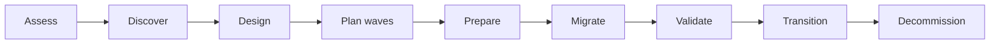

# Datacenter Transformation

**Datacenter migration | Infrastructure modernisation | Transition | Decommissioning**

My professional experience includes datacenter migration and decommissioning initiatives across the **United States, Norway and APAC**. Working across different regions and enterprise environments has reinforced the importance of disciplined discovery, dependency understanding, migration sequencing, stakeholder coordination, controlled change and operational transition.

This repository presents the delivery approach and reusable controls behind a well-governed transformation. The examples are synthetic and publication-safe; they do not reproduce customer plans, internal records or production architecture.

## Delivery experience translated into a repeatable approach

A successful datacenter transformation is more than moving workloads. It requires a clear view of what exists, how services depend on one another, what the target environment must provide, how each migration will be validated, and when the legacy estate can be safely retired.

The lifecycle represented here is:

## Key delivery workstreams

| Workstream | Delivery focus | Typical outcome |
|---|---|---|
| Discovery | Inventory, ownership, dependencies and utilisation | Validated scope and baseline |
| Architecture | Target-state design, connectivity, security and resilience | Agreed technical design |
| Migration planning | Sequencing, waves, prerequisites and downtime | Executable migration plan |
| Execution | Change control, cutover coordination and rollback readiness | Controlled implementation |
| Validation | Service, performance, security and user checks | Evidence-based acceptance |
| Transition | Support model, runbooks, monitoring and ownership | Operational handover |
| Decommissioning | Data retention, access removal, asset disposal and closure | Controlled retirement |

## What this portfolio demonstrates

- Structuring discovery and dependency mapping before migration decisions
- Breaking complex scope into manageable migration waves
- Tracking prerequisites, technical owners, business validation and readiness
- Preparing cutover steps, decision points and rollback criteria
- Managing risks across network, DNS, identity, data, capacity and suppliers
- Planning service acceptance, hypercare, operational handover and decommissioning

## Detailed portfolio artefacts

- [Synthetic hybrid datacenter migration case study](case-study/SYNTHETIC-HYBRID-DATACENTER-MIGRATION.md)
- [Discovery inventory template](templates/DISCOVERY-INVENTORY.md)
- [Service dependency mapping guide](templates/DEPENDENCY-MAPPING.md)
- [Migration wave tracker (CSV)](templates/MIGRATION-WAVE-TRACKER.csv)
- [Cutover and rollback runbook template](runbooks/CUTOVER-ROLLBACK-RUNBOOK.md)
- [Risk register (CSV)](templates/RISK-REGISTER.csv)

## Example: migration readiness

Before a workload enters a migration wave, confirm:

- [ ] Scope, service owner and acceptance criteria are agreed
- [ ] Upstream and downstream dependencies are mapped
- [ ] Backup and restore approach is understood and tested
- [ ] Network, DNS, firewall and identity prerequisites are validated
- [ ] Monitoring and alerting are operational
- [ ] Change approvals and stakeholder communications are complete
- [ ] Cutover sequence and decision points are rehearsed
- [ ] Rollback plan, trigger and decision authority are clear
- [ ] Business and technical validation owners are available
- [ ] Support handover and hypercare arrangements are agreed

## Responsible publication

The case study, identifiers, architecture, volumes, timelines and sample records in this repository are synthetic and must not be interpreted as actual project metrics or verified personal outcomes. My real professional experience is described separately at a high level, without customer names, confidential information or unapproved project details. The templates are starting points and must be adapted to each organisation's change, security and service-management controls.
