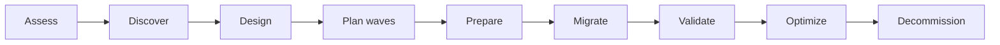

# Datacenter Transformation

**Discovery | Migration planning | Transition | Decommissioning**

A collection of reusable methods and templates for planning and delivering datacenter and infrastructure transformation initiatives.

This repository turns broad delivery experience into generic, reusable guidance. It does not contain customer migration plans, internal records or production architecture.

## Transformation lifecycle

## Workstreams

| Workstream | Typical activities | Evidence / output |
|---|---|---|
| Discovery | Inventory, ownership, dependencies, utilization | Validated inventory |
| Architecture | Target-state design, connectivity, security | Approved design |
| Migration planning | Waves, sequencing, prerequisites, downtime | Migration plan |
| Execution | Change control, cutover, rollback | Change and execution record |
| Validation | Service, performance, security and user checks | Acceptance evidence |
| Transition | Support model, runbooks, monitoring | Operational handover |
| Decommissioning | Data retention, access removal, asset disposal | Closure record |

## Migration wave planning template

| Field | Example / guidance |
|---|---|
| Wave ID | WAVE-001 |
| Service / application | Synthetic service name |
| Business owner | Role, not a real person's details |
| Technical owner | Role or team |
| Dependencies | Upstream and downstream synthetic service IDs |
| Target platform | Generic target environment |
| Prerequisites | Network, identity, DNS, backup, access |
| Planned window | Approved change window |
| Validation | Functional and non-functional checks |
| Rollback trigger | Measurable failure condition |
| Status | Proposed / ready / in progress / complete |

## Cutover readiness checklist

- [ ] Scope, owners and acceptance criteria confirmed
- [ ] Dependencies and data flows mapped
- [ ] Backup and restore tested
- [ ] Network, DNS, firewall and identity prerequisites validated
- [ ] Monitoring and alerting operational
- [ ] Change approvals and stakeholder communications complete
- [ ] Cutover sequence and decision points rehearsed
- [ ] Rollback plan and rollback authority confirmed
- [ ] Business and technical validation owners available
- [ ] Support handover and hypercare arrangements agreed

## Decommissioning controls

- Confirm service owner approval and dependency clearance.
- Verify retention, legal hold and data sanitization requirements.
- Remove access and credentials through approved processes.
- Update asset, configuration and service records.
- Confirm monitoring, backup and support dependencies are retired.
- Obtain closure evidence and formal sign-off.

## Risk categories to assess

- Unknown or undocumented dependencies
- Data integrity and consistency
- Network, DNS and identity readiness
- Downtime and business continuity
- Capacity and performance
- Security and access control
- Supplier and change-window dependencies
- Rollback feasibility and recovery time

## Roadmap

- [ ] Add a discovery workbook template
- [ ] Add a dependency-mapping example using synthetic services
- [ ] Add a migration-wave tracker
- [ ] Add a cutover and rollback runbook
- [ ] Add a decommissioning evidence checklist

All examples must use synthetic service names, sites, IP addresses and data.
