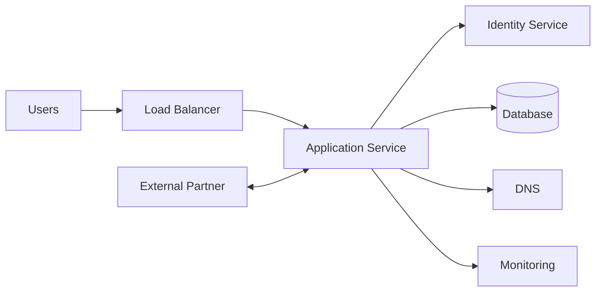

# Service Dependency Mapping Guide

Dependency mapping identifies what must remain available for a service to function before, during and after migration.

> All identifiers and examples below are fictional. Do not publish real network paths, IP addresses, firewall rules, credentials or customer architecture.

## 1. Dependency categories

| Category | Examples | Questions |
|---|---|---|
| Identity | Directory, SSO, MFA, service accounts | Can users and workloads authenticate at target? |
| Name and time | DNS, NTP, IPAM | Are records, resolvers and time sources reachable? |
| Network | Routing, firewall, load balancer, proxy | Are required flows approved and tested? |
| Data | Database, file services, queues | What consistency and sequencing constraints exist? |
| Security | PKI, certificates, secrets, key management | Are trust chains and renewal processes ready? |
| Platform | Hypervisor, storage, backup, orchestration | Are capacity and platform dependencies available? |
| Operations | Monitoring, logging, CMDB, ITSM | Can teams observe and support the service? |
| External | SaaS, suppliers, partners, payment gateways | Are allowlists, contracts and test windows arranged? |

## 2. Example dependency register

| Consumer | Provider | Relationship | Criticality | Migration consideration |
|---|---|---|---|---|
| SVC-PORTAL | SVC-DNS | Name resolution | High | Validate records and resolver path |
| SVC-PORTAL | SVC-ID | Authentication | High | Test sign-in and service identity |
| SVC-PORTAL | SVC-DB | Data access | Critical | Coordinate consistency and cutover |
| SVC-PORTAL | SVC-MON | Monitoring | Medium | Confirm target telemetry |
| SVC-API | EXT-PARTNER | External API | High | Confirm endpoint and partner test |

## 3. Mapping method

1. Start with the business service and its user journeys.
2. Identify runtime, data, identity, network and operational dependencies.
3. Validate findings with application, platform and security owners.
4. Record directionality: consumer, provider or bidirectional.
5. Identify shared dependencies used by multiple services.
6. Classify impact and migration constraints.
7. Group tightly coupled services into a migration wave where justified.
8. Revalidate the map after design changes and before cutover.

## 4. Review questions

- What fails if this dependency is unavailable?
- Is the dependency synchronous, asynchronous or batch-based?
- Is it shared across multiple applications?
- Does it rely on hard-coded addresses, certificates or allowlists?
- Does the target environment have equivalent connectivity and controls?
- What is the test evidence and who accepts it?
- Can the dependency be migrated independently?
- What is the fallback if the provider is unavailable?

## 5. Simple Mermaid example

This is a conceptual example, not a production network design.

## 6. Quality checks

- Every critical service has reviewed upstream and downstream dependencies.
- Shared services and external integrations are explicitly represented.
- Owners validate the relationships and migration constraints.
- High-impact unknowns have actions and due dates.
- The migration plan includes validation for critical dependencies.
